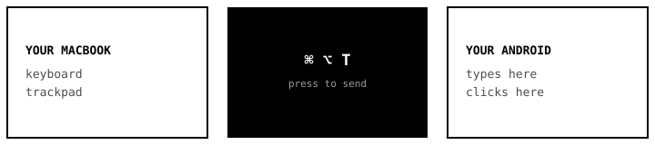

# Handover

**One shortcut sends your Mac's keyboard and trackpad to an Android phone or tablet — no app on the device, no mirroring, no root.**

<p>
  <a href="LICENSE"></a>
  
  
  <a href="https://github.com/samirsawarkar/handover/actions/workflows/shellcheck.yml"></a>
</p>

```bash
curl -fsSL https://raw.githubusercontent.com/samirsawarkar/handover/main/install.sh | bash
```

<video src="assets/demo.mp4" controls muted playsinline width="600">
  Demo: pressing cmd-option-T sends the Mac keyboard and trackpad to an Android tablet.
</video>



Press **⌘ + ⌥ + T** and your typing goes to the tablet. Press it again and you are
back on your Mac. You keep looking at the tablet's own screen the whole time —
nothing is mirrored on your Mac, and nothing is installed on the tablet.

It is Universal Control, but for Android.

## Install

Open **Terminal** (⌘ + Space, type "Terminal", press Enter), paste the command
at the top of this page, press Enter. It installs what is needed, finds your
tablet, and asks you to switch on one macOS permission. That is the whole setup.

Requires [Homebrew](https://brew.sh). If you do not have it, the installer says so.

## Web Control Center (Dashboard)

For visual device control, live screen preview, and drag-and-drop file transfers, launch the built-in Control Center:

```bash
python3 handover_server.py
```
Open **[http://localhost:5050](http://localhost:5050)** in your browser:

- **Dual Modes:** Switch seamlessly between **iPad Sidecar Mode** (floating companion window) and **Universal Control Mode** (windowless direct control).
- **Ultra-Fast Live Preview:** Low-latency hardware-accelerated preview with touch/tap input support.
- **Live Resource Footprint:** Real-time Mac and Android RAM/CPU consumption metrics (~25 MB Mac RAM).
- **Drag-and-Drop File Transfer:** Instant wireless push to `/sdcard/Download/` with Android media scanner indexing.
- **Dynamic App Launcher:** 1-click launch for recent and top Android applications with clean vector brand icons.
- **One-Click Complete Close-up:** Cleanly disconnects scrcpy sessions, puts phone to sleep, and resets state.

## Why this exists

Apple's Universal Control only talks to Apple devices. Logitech Flow only moves
between computers, and needs Logitech hardware. Nothing shipped lets a MacBook
keyboard type on an Android tablet sitting next to it — so this does.

| | Handover | Universal Control | Logitech Flow | KDE Connect |
|---|---|---|---|---|
| Mac → Android | **yes** | no | no | limited |
| App on the Android device | **none** | — | — | required |
| Root or Developer options | **none** (USB) | — | — | not required |
| Mirrors a screen onto your Mac | **no** | no | no | no |
| Cost | **free, open source** | free, Apple only | needs their hardware | free |

## Two ways to connect

**USB cable — recommended.** Nothing to enable on the tablet. Plug in, tap OK on
the prompt the tablet shows, done. Survives reboots.

**Wi-Fi.** No cable, but the tablet needs *Developer options → Wireless
debugging*, and Android switches that back off after every restart.

| | USB cable | Wi-Fi |
|---|---|---|
| Developer options | not needed | required, always |
| Survives a reboot | yes | no, switch it on again |
| Setup | plug in | pairing, IP address |

## Troubleshooting

<details>
<summary><strong>"Could not see your tablet"</strong></summary>

- Use a **data** cable. Cables bundled with chargers are frequently power-only and
  cannot carry data — no software can work around that.
- macOS blocks unfamiliar USB devices: System Settings → Privacy & Security →
  **Allow accessories to connect**.
- Plug straight into the Mac. Hubs and docks break the USB accessory protocol.
</details>

<details>
<summary><strong>The shortcut does nothing</strong></summary>

System Settings → Privacy & Security → **Accessibility** → Hammerspoon must be on.
If it already is, switch it off and on again, then restart Hammerspoon. macOS
sometimes keeps the checkbox lit after the permission has actually lapsed.
</details>

<details>
<summary><strong>Typing works but the trackpad does not</strong></summary>

Press the shortcut again to reconnect. The trackpad is captured when the
connection starts; if that did not catch the first time, reconnecting fixes it.
</details>

<details>
<summary><strong>Wi-Fi stopped working after a reboot</strong></summary>

Switch *Wireless debugging* back on in Developer options. This is Android's
behaviour and no tool can prevent it. Use a cable if you can.
</details>

## How it works

Android does not let an ordinary app inject keystrokes — that needs a
system-level permission no installable app can hold. There are exactly two ways
in, and Handover uses both:

- **USB:** [scrcpy](https://github.com/Genymobile/scrcpy)'s OTG mode speaks the
  **AOAv2** accessory protocol, so your Mac registers as a genuine USB keyboard
  and mouse. The tablet simply thinks hardware was plugged in. No debugging, no
  permissions, no app.
- **Wi-Fi:** scrcpy's normal mode over **adb**, which is why Developer options
  are unavoidable there.

[Hammerspoon](https://www.hammerspoon.org) supplies the global shortcut.

<details>
<summary><strong>Why a window exists at all</strong></summary>

scrcpy captures the trackpad only while one of its windows holds focus, and macOS
refuses focus to a window too small to be real. So Handover lets a small window
exist for a moment, clicks it to capture the mouse, then moves it far off-screen.
The capture survives the move, so nothing is visible afterwards.

This was found the hard way: a 1-pixel window receives neither focus nor clicks,
and no scrcpy flag forces mouse capture.
</details>

## Limitations

- macOS 13+, Apple Silicon or Intel.
- USB mode needs a real data connection — no hubs, no charge-only cables.
- Wi-Fi mode needs both devices on the same network with AP isolation off.
- The tablet's IP is stored at setup; if your router hands out a new one, run the
  installer again.
- Requires Homebrew, and Hammerspoon needs Accessibility permission.

## Contributing

Issues and pull requests are welcome — see [CONTRIBUTING.md](CONTRIBUTING.md).
Good first contributions are listed there, including an uninstall script,
a configurable shortcut, and testing on devices other than Samsung.

## Credits

Built on [scrcpy](https://github.com/Genymobile/scrcpy) by Genymobile and
[Hammerspoon](https://www.hammerspoon.org). Handover is the glue and the setup
experience; those projects do the hard parts.

## License

MIT — see [LICENSE](LICENSE).

---

<sub><strong>Keywords:</strong> use Mac keyboard on Android · type on Android from Mac ·
MacBook trackpad on Android tablet · Universal Control for Android · Logitech Flow
alternative for Android · share keyboard and mouse between Mac and Android ·
scrcpy OTG keyboard · control Android from macOS without mirroring · KVM for Mac and
Android · Samsung Galaxy Tab with MacBook keyboard</sub>
